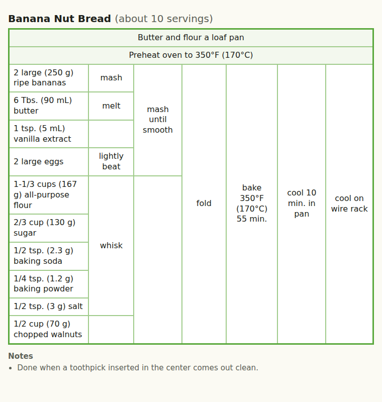

# recipe-to-table

A Claude skill that rewrites an ordinary recipe (an ingredient list and paragraphs of steps) as a **tabular recipe chart**. The chart shows what to set up, what goes together, and in what order, all at a glance.



Read the chart top to bottom, then left to right:

- **Setup rows** across the top: things to do before you touch an ingredient (prepare the pan, preheat the oven).
- **Ingredients** down the left, grouped by the stage where they're used.
- **Actions** moving rightward. Each action cell spans the ingredients it acts on:
  - first, preparing individual ingredients ("mash", "melt")
  - then, combining them ("whisk", "fold")
  - finally, the steps that finish the dish ("bake", "cool"), where the last column spans every row

The notation comes from Michael Chu's [Cooking for Engineers](https://www.cookingforengineers.com/). This project writes its rules down precisely enough for Claude to apply them to any recipe, and draws the result the same way every time.

## Install

Pick whichever fits how you use Claude.

### Claude Code: plugin (recommended)

```
/plugin marketplace add jjainschigg-r/recipe-to-table
/plugin install recipe-to-table@recipe-to-table
```

Updates arrive through `/plugin update`.

### Claude Code: standalone skill

```bash
git clone https://github.com/jjainschigg-r/recipe-to-table.git
cp -r recipe-to-table/skills/recipe-to-table ~/.claude/skills/
```

To make it available in one project only, copy it to that project's `.claude/skills/` folder instead.

### Claude.ai: uploaded skill

1. Download `recipe-to-table.zip` from the [latest release](https://github.com/jjainschigg-r/recipe-to-table/releases/latest), or build it yourself with `scripts/build-skill-zip.sh`.
2. In Claude.ai, open **Settings → Capabilities**. Check that code execution is turned on.
3. Upload the zip in the **Skills** section.

### Claude.ai: Project

This option needs no code execution.

1. Create a Project.
2. Paste the contents of [`claude-ai/project-instructions.md`](claude-ai/project-instructions.md) into the Project's instructions.
3. Upload these files to the Project's knowledge:
   - `skills/recipe-to-table/references/method.md`
   - `skills/recipe-to-table/assets/recipe-table.html`
   - the three files in `skills/recipe-to-table/examples/`

## Use

Paste a recipe, attach a file, or give a link, and ask Claude to turn it into a table. In Claude Code, you can also type `/recipe-to-table`.

You get a self-contained HTML page. It prints cleanly, works in light and dark mode, and needs no internet connection. Claude also lists the judgement calls it made, such as how it grouped ingredients or resolved an ambiguity in the source.

To change the chart, ask in plain language: "group the spices together", "make the cells terser", "add metric amounts". In Claude Code, Claude keeps the recipe as a `.json` file next to the page, edits that, and re-renders.

## How it works

1. **Classify.** Claude sorts every clause of the method into one of four kinds:
   - a setup row
   - preparation of a single ingredient
   - an action that combines things or continues working them
   - a note
2. **Build a tree.** The ingredients are the ends of the branches, each action joins its inputs together, and the final step is the root. This tree is saved as a small JSON file.
3. **Check.** Claude confirms that every ingredient and every step in the source appears exactly once, with amounts copied word for word.
4. **Render.** A small script turns the tree into the table. It follows four fixed rules:
   - Each action sits as far left as its inputs allow.
   - Each action cell spans exactly the ingredients beneath it.
   - Gaps are left blank, never stretched.
   - Blank cells in the same column merge across neighbouring groups.

   Because the script does the drawing, the same recipe always produces the same table.

The full rules are in [`references/method.md`](skills/recipe-to-table/references/method.md).

## Repository layout

```
.claude-plugin/
  plugin.json              plugin manifest
  marketplace.json         lets this repo act as its own plugin marketplace
skills/recipe-to-table/    the skill: everything Claude uses
  SKILL.md                 workflow
  references/method.md     rules for turning a recipe into a table
  assets/recipe-table.html page template; its script draws the table
  scripts/render.py        checks the recipe JSON and writes the page (Python 3, no packages)
  examples/                three worked examples
claude-ai/
  project-instructions.md  instructions for the Claude.ai Project option
scripts/build-skill-zip.sh packages the skill for Claude.ai upload
tests/                     validation tests (Python) and table-layout tests (Node)
```

## Development

The tests need Python 3 and Node 18 or later, with no other dependencies:

```bash
python3 -m unittest discover -s tests
node tests/test_layout.mjs
```

The layout test renders the banana nut bread example and compares the result against the reference chart above, cell by cell.

To release, bump the version in `.claude-plugin/plugin.json` and `.claude-plugin/marketplace.json`, add a `CHANGELOG.md` entry, and push a tag such as `v1.1.0`. GitHub Actions runs the tests and publishes a release with the Claude.ai zip attached.

See [CONTRIBUTING.md](CONTRIBUTING.md) for how to propose changes.

## License

[MIT](LICENSE)
